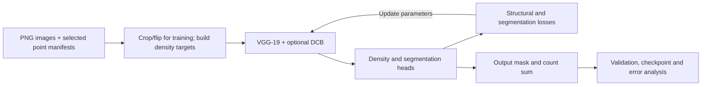
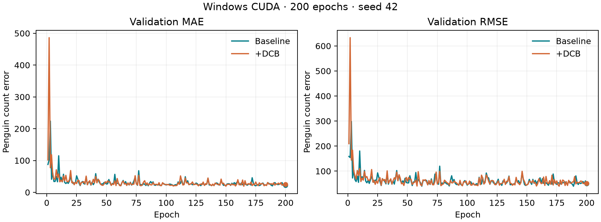
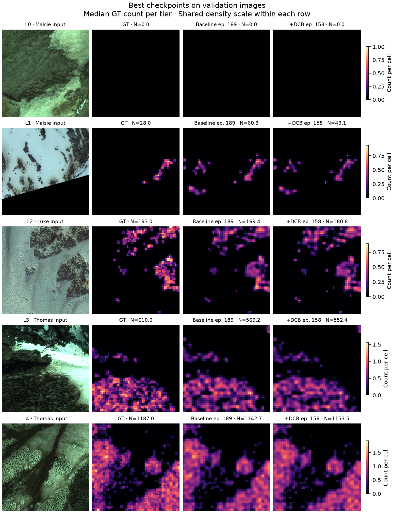
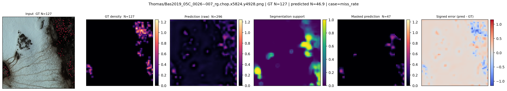

# Midterm Report: Pygos-Net

**Course:** DDA4220 Deep Learning  
**Team members:** A, B, C and D  
**Date:** 18 November 2026  
**Project:** Multi-Scale Density Estimation for Antarctic Penguin Counting  
**Evidence snapshot:** [integration/abcd-interfaces, commit 2728799](https://github.com/ZaOchuAN-08/DDA4220_pygos-net/tree/2728799a34ea50a6fb4d1bc48f60758aac42113d)

This report describes the implementation and committed experiment records in the integration snapshot above. A configuration file alone does not establish that an experiment was completed. The reported experiments use the RTX 4050 and CUDA. Earlier MPS experiments are outside the scope of this report.

## 1. Project Overview and Objectives

We aim to count penguins in low-resolution aerial images. Individual penguins occupy only a few pixels. Rock, shadows and snow can produce similar visual patterns. We use density-map estimation instead of locating each animal with a detection box. A density map assigns count mass to image locations. Its sum gives the predicted count.

Our starting point is the VGG-19 dual-branch method of Qian et al. [1]. One branch predicts density. The other predicts the support of the density map. Support means a region that can contain non-negligible target density. It does not mean the outline of an animal. Segmentation-guided feature dampening and output masking belong to this baseline. We retain them as baseline components.

The proposal investigates two additions: a Dilated Context Block (DCB) for multi-scale features, and a hard-negative loss for high-density errors in verified background regions. The core objectives are to establish a working baseline, measure each addition's effect, and check whether lower background error comes at the cost of undercounting dense colonies. Terrain analysis is an optional extension.

At midterm, the Baseline and +DCB have completed 200-epoch CUDA runs. Their best checkpoints have been evaluated on the validation set. The following sections separate implemented components, measured results and remaining work.

## 2. Methodology and Implementation Progress

**Implementation and experiment status.** An ablation experiment switches a component on or off to examine its effect. The planned design has four configurations.

| Configuration | DCB | Full hard-negative loss | Current status |
|---|---|---|---|
| Baseline | Off | Off | Implemented; 200-epoch CUDA run and validation evaluation complete |
| +DCB | On | Off | Implemented; 200-epoch CUDA run and validation evaluation complete |
| +Hard-Negative | Off | Planned | YAML configuration exists; current background term is ordinary mean squared density; full loss and training pending |
| Full proposed Pygos-Net | On | Planned | YAML configuration exists; full hard-negative loss and training pending |

The completed work is supported by the following artifacts [R1–R4]. Source files establish what is implemented. Histories, checkpoints and evaluation records establish which experiments have results.

| Completed work | Evidence in integration |
|---|---|
| Selected annotations, fixed splits and image preparation | `data/processed/manifest.jsonl`, `data/splits/`, `scripts/prepare_data.py`, `scripts/prepare_images.py` |
| Density targets, synchronized augmentation and data loading | `src/pygosnet/data/`, `tests/test_data.py`, `tests/test_image_preparation.py` |
| VGG-19 dual-branch Baseline and switchable DCB | `src/pygosnet/models/`, `tests/test_models.py` |
| Structural loss, segmentation loss and prototype background penalty | `src/pygosnet/losses/`, `tests/test_losses.py`, `tests/test_losses_self.py` |
| Training, checkpoint loading, prediction and portable pipeline | `scripts/train.py`, `scripts/predict.py`, `scripts/run_pipeline.py`, `src/pygosnet/engine/` |
| Two 200-epoch CUDA runs | `experiments/preliminary_epoch200_windows/` |
| Best-checkpoint validation tables, figures and error diagnostics | `experiments/best_checkpoint_eval/`, `scripts/evaluate.py`, `src/pygosnet/eval/` |
| Faster R-CNN feasibility audit | `experiments/baselines/faster_rcnn_feasibility.json`; no trained detector result |

**Data preparation.** We prepared 738 RGB images of 448 × 448 pixels. The selected annotation manifest contains 134,767 penguin points. The committed overlap decision uses LUKE annotations for conflicting image records. The manifest stores each image path, point coordinates, annotation source and count.

| Split | Images | Annotated penguins | Use |
|---|---:|---:|---|
| Training | 446 | 83,875 | Parameter updates |
| Validation | 146 | 23,771 | Checkpoint selection and preliminary analysis |
| Test | 146 | 27,121 | Reserved for final evaluation |
| Total | 738 | 134,767 | Current selected dataset |

The split is a fixed-seed reconstruction with the paper's reported split sizes. It is not a recovered copy of the authors' image assignment. The reference publication reports 135,279 annotations. Our selected manifest contains 512 fewer annotations. Annotation selection and source-record differences require a clear provenance statement. Partitioning the same images into different splits does not itself change the total count. We therefore report the actual manifest total and avoid direct benchmark claims against the published test results. The audit and split metadata record these decisions [R1].

Training applies a random 256 × 256 crop and a horizontal flip with probability 0.5. Point coordinates follow both transforms. We rebuild the target after cropping. Each retained point contributes a normalized Gaussian with sigma = 4 input pixels. Sum-pooling reduces the target to stride 8. Stride 8 means one output cell for every eight input pixels along each axis. The target sum remains equal to the retained point count. The threshold 0.001 defines the segmentation and structural-loss support. Images use ImageNet normalization. Validation and final test inference use full images without random crops or flips.

The image-preparation script extracts only the PNGs referenced by the committed manifests. It excludes macOS metadata. It checks all 738 image paths, image integrity and 448 × 448 dimensions. This step does not rewrite annotations or splits.

**Model implementation.** The encoder uses ImageNet-pretrained VGG-19 [2]. We remove its last pooling layer and classifier. Bilinear upsampling restores stride-8 features. A 448 × 448 input produces a 56 × 56 feature grid with 512 channels.

The segmentation and density heads each use channel widths 512 → 256 → 128 → 1. Their first two convolutions use 3 × 3 kernels. Their last convolution uses a 1 × 1 kernel. Sigmoid converts the segmentation output into a probability, denoted by `S`. ReLU makes the density output, denoted by `D`, nonnegative. Features at positions where `S < 0.5` are multiplied by 0.1 before density regression. The hard threshold does not pass density gradients directly to the segmentation head. Segmentation supervision is therefore necessary.

The DCB applies three parallel 3 × 3 convolutions with dilation rates 1, 2 and 4. Dilation spaces the kernel samples to cover a larger area without further downsampling. Each branch has 128 output channels. We concatenate the branches and apply a 1 × 1 projection to restore 512 channels. ReLU follows each branch and the projection. The branch width is our current implementation choice. The proposal did not specify that width. The Baseline contains 22,974,530 parameters. The +DCB model contains 24,941,506 parameters, an increase of about 8.56%.

The shared `PygosNet` class controls the DCB with `use_dcb`. Training returns unmasked density, segmentation probability and segmentation logits. Logits are the scores before sigmoid. Counting uses the final output mask:

```text
D_out = D × 1[S ≥ 0.5]
Predicted count = sum(D_out)
```

The density sum already represents count mass. We do not multiply it by the downsampling area. A separate small CNN exists for data-flow checks. It is not the model used in the CUDA results below.

**Loss implementation and pipeline.** The current loss package contains a masked structural loss, a segmentation loss and a prototype background penalty. The structural loss compares masked density maps at three average-pooling scales. It uses the Structural Similarity Index (SSIM) to compare local patterns [3, 4]. The segmentation loss uses binary cross-entropy on logits. The CUDA experiments use the current equal foreground/background weights and a segmentation coefficient of 0.1. The additional background term is disabled in both reported runs.

The prototype background penalty is the mean squared predicted density on background cells. The switch named `use_hard_negative` currently enables this penalty. It does not perform Top-K selection. The four ablation YAML files therefore provide configuration scaffolding, rather than four completed versions of the proposed method. Section 4 lists the missing parts. Empty targets, absent background candidates and gradient propagation have dedicated checks.



*Figure 1. Implemented training and validation flow. Validation uses full images. Test evaluation is reserved for the final selected method.*

The training entry point builds the model and loss from YAML configuration. The Trainer handles parameter updates, validation, CSV logs and checkpoints. The portable pipeline selects an available CUDA device, then MPS, then CPU. It can also use a device selected by the user. Its default mode checks the environment and data without starting training. Evaluation mode loads an existing checkpoint and produces predictions, metrics and figures. A separate explicit mode trains and then evaluates.

The test suite at the reported integration snapshot passed 88 automated tests. Coverage includes target count preservation, output shapes, gradients, loss edge cases, masking, checkpoint use, pipeline failures and evaluation metrics. This confirms tested engineering behaviour. It does not establish counting accuracy on unseen test images.

**Reference methods and optional work.** We audited Faster R-CNN feasibility, but we did not train or evaluate a detector. The raw annotation exports contain box fields with a median longest side of 6 pixels. About 97.3% are no larger than 8 pixels on that side. Box semantics, duplicate records and suitability for detector training still require review. These statistics are an audit of raw exports, not a detector benchmark on the selected manifest. We also paused the optional terrain analysis. The current pipeline has no verified georeferencing and no matching Digital Elevation Model (DEM). A DEM supplies terrain elevation; without compatible spatial data, tile-to-terrain alignment is not justified.

## 3. Preliminary Experiments and Results

**CUDA experiments.** We trained the Baseline and +DCB for 200 epochs on an NVIDIA GeForce RTX 4050 Laptop GPU with about 6 GB of memory. Both runs used the same manifests and the settings below [R2].

| Setting | Actual CUDA runs |
|---|---|
| Encoder initialization | VGG-19 ImageNet-1K V1 |
| Optimizer | Adam |
| Learning rate | 0.00001 |
| Weight decay | 0.0001 |
| Training budget | 200 epochs |
| Batch size | 1 |
| Seed | 42 |
| DataLoader workers | 0 |
| Training input / validation input | 256 × 256 / 448 × 448 |
| Additional background loss | Disabled |
| Counting mask | Segmentation probability ≥ 0.5 |
| Checkpoint selection | Lowest validation MAE + RMSE from epoch 101 |
| Recorded software | Python 3.11.8; PyTorch 2.14.1+cu126; torchvision 0.29.1+cu126; CUDA 12.6 |

The proposal planned 600 epochs and batch size 16. The actual budget and batch size differ from those targets. The source protocol records the training commit, manifest hashes, hardware and a DCB training resumption. The selected checkpoints are epoch 189 for Baseline and epoch 158 for +DCB. The evaluator re-exported their predictions and assessed the same 146 validation images [R3].

MAE is the average absolute count error per image. RMSE gives more weight to large errors. Dataset-level relative count error is the absolute difference between the total predicted and total true counts, divided by the total true count. This last measure can hide cancellation between overcounting and undercounting.

| Best-checkpoint result | Baseline | +DCB |
|---|---:|---:|
| Selected epoch | 189 | 158 |
| Validation images | 146 | 146 |
| MAE | 20.24 | 19.96 |
| RMSE | 39.69 | 40.63 |
| Dataset-level relative count error | 2.94% | 3.75% |
| Mean signed count error per image | +4.78 | +6.10 |
| Total predicted count | 24,469.53 | 24,662.24 |
| Total true count | 23,771 | 23,771 |

*Table 1. Best-checkpoint validation results. Lower MAE, RMSE and relative count error are better. Validation also selected these checkpoints, so this is not an independent test estimate.*

The DCB lowers MAE by about 0.28 penguins per image, or 1.4%. It raises RMSE and dataset-level relative count error. These results do not show a consistent improvement. Section 4 sets out the limits of this single-seed comparison.



*Figure 2. CUDA validation curves across 200 epochs. The main comparison uses the selected checkpoints, not necessarily the last points in these curves.*

| Tier | Validation images | Baseline MAE | +DCB MAE | Baseline RMSE | +DCB RMSE |
|---|---:|---:|---:|---:|---:|
| L0 | 35 | 1.88 | 2.09 | 5.75 | 5.36 |
| L1 | 53 | 12.42 | 11.95 | 20.26 | 19.15 |
| L2 | 43 | 29.46 | 27.96 | 42.40 | 41.73 |
| L3 | 12 | 68.02 | 69.04 | 101.00 | 105.77 |
| L4 | 3 | 49.29 | 58.91 | 49.55 | 61.92 |

*Table 2. Best-checkpoint results by true count: L0 = 0; L1 = 1–100; L2 = 101–500; L3 = 501–1000; L4 > 1000.*

The DCB lowers MAE in L1 and L2. It raises MAE in L0, L3 and L4. Its estimated background share of the final predicted density increases from 6.31% to 7.72%. This measure uses point cells with a one-cell support margin. The current evidence does not support the proposal's hypothesis that DCB reduces background false positives. Only three validation images belong to L4. We therefore treat changes in that tier as uncertain.

The fixed epoch-200 results provide a separate view. Baseline has MAE 21.48 and RMSE 50.56. The +DCB model has MAE 25.12 and RMSE 50.70. We keep these records, but we do not mix final-epoch metrics with best-checkpoint tables. The difference between these views shows why the checkpoint rule must be stated before model comparison.

**Masking and qualitative checks.** The evaluator retains both raw density and masked density. Without the final mask, validation MAE is 221.34 for Baseline and 213.95 for +DCB. The final mask reduces these values to the results in Table 1. It is therefore an important part of the current counting method.

The spatial analysis estimates that masking removes about 30,788 and 29,614 count units outside the point-support region. It estimates a loss of matched mass equal to 0.36% and 0.25% of the true total. These quantities are grid-based density diagnostics. They are not animal detection recall or the fraction of individual penguins removed. The support definition and Gaussian spread affect them. They do not prove that masking cannot cause local undercounting.



*Figure 3. Input, target density, Baseline prediction and +DCB prediction for one image from each tier. Images were selected by the median true count within each tier. Density panels share a colour scale within each row. GT means ground truth. These examples do not replace the full-set metrics.*

The error galleries also contain difficult cases [R3]. Figure 4 shows an L2 validation image with 127 annotated penguins. The raw Baseline density sums to about 296. Output masking reduces the prediction to 46.9. The +DCB model predicts about 71.5 after masking on the same image. Both models undercount. This selected example illustrates a failure case; it does not estimate its frequency in the dataset.



*Figure 4. Baseline best-checkpoint error analysis for an L2 image. From left to right: input with annotation points, target density, raw predicted density, segmentation probability, masked predicted density, and signed density error (masked prediction minus target). The figure rounds the masked count to 47; the recorded value is 46.88. Blue error regions indicate underprediction. Density values represent count mass per output cell. The segmentation panel uses a separate probability scale from 0 to 1.*

Several annotated clusters have less predicted density than target density after masking. The raw prediction also contains responses away from annotated clusters. Removing those responses improves the total count relative to the raw output, but the masked output still undercounts. This figure alone does not separate the effects of density regression and segmentation errors. We will inspect both components before changing background suppression.

## 4. Challenges and Limitations

**The DCB benefit is not established.** Best-checkpoint MAE improves slightly, but RMSE, total-count error and estimated background share worsen. We need controlled repeats and targeted error inspection before making an architectural claim.

**The background objective is incomplete.** The full method requires a reliable background mask outside truncated Gaussian support and a tolerance margin. It also requires Top-K selection and the planned rho = 0.1 and eta = 0.5 mixture. Top-K selects the highest predicted background densities. The parameter rho sets the selected fraction. The parameter eta sets the weight of this selected group relative to the full background group. We must implement and test this objective before launching the two missing background-loss configurations. Per-image empty-background handling must remain well defined.

**The experiments do not yet provide strict replication.** Current augmentation and output interfaces are checked. Input normalization and the exact structural/segmentation loss details still need comparison with the reference implementation. Equal segmentation weights are the current code default. They should not be described as a verified reproduction of the reference weighting. SSIM is used inside training; per-image density correlation and SSIM evaluation scores have not yet been implemented.

**Reproducibility needs improvement.** Shared non-DCB head tensors were not explicitly matched between variants. The DCB run resumed after epoch 161 without restoring random-number or DataLoader state. Its selected epoch-158 checkpoint predates that resumption. The later curve and final epoch-200 result include it. The driver also changed at resumption, as recorded in the protocol. We will record these conditions and improve initialization and state restoration for subsequent comparisons.

**Coverage and evidence remain limited.** Only two of the four planned configurations have completed training. The experiments use one seed, 200 epochs and batch size 1. The test set has not been used for model selection or performance evaluation. The small dense-tier sample sizes limit conclusions about L3/L4. Full Top-K background-loss results, multi-seed estimates and final test results remain future work.

## 5. Next Steps and Timeline

| Period | Planned work | Completion evidence |
|---|---|---|
| 19–25 November | Confirm the common training and selection protocol. Implement the full hard-negative objective. Check reference normalization and loss details. Improve shared initialization and checkpoint state handling. | Agreed configurations; numeric and gradient tests; a small-sample fitting check |
| 26 November–2 December | Run the missing +Hard-Negative and DCB+Hard-Negative configurations. Run matched controls where the protocol changes. Evaluate L0–L4 with the same evaluator. | Four-configuration table with checkpoints, settings and per-image records |
| 3–5 December | Add seed repeats if compute allows. Review high-error cases. Add planned density-level evaluation measures. Confirm that terrain work remains out of scope unless compatible data become available. | Variability estimates where available; case analysis; documented extension decision |
| 6–10 December | Freeze the model and evaluation protocol. Perform the reserved test evaluation after model decisions are complete. Write the final paper. | Final test table; reproducible commands; complete paper draft |
| 11–15 December | Check the repository and figures. Prepare the presentation. | Reproduction checklist and final presentation |

The schedule depends on GPU access and successful loss integration. We will keep the same feasible budget across compared configurations. Any change from the proposal will be stated. Test results will not be used to choose loss weights or model settings.

## 6. Team Contributions

A/B/C/D follow the division recorded in the repository. The table describes implemented artifacts in each workstream. Experiment execution and interface integration are reported as shared work because the committed run records do not identify an individual operator.

| Member | Implemented contribution | Repository evidence |
|---|---|---|
| A — Data and training infrastructure | Annotation parsing and overlap handling; selected manifests and fixed splits; density targets, crop/flip transforms and data loading; training, validation, logging and checkpoint utilities. | `src/pygosnet/data/`, `src/pygosnet/engine/trainer.py`, `src/pygosnet/engine/checkpoint.py`, `scripts/prepare_data.py`, `scripts/train.py`, data and engine tests |
| B — Model architecture | VGG-19 encoder and dual prediction heads; segmentation-guided feature dampening and final output masking; switchable DCB; output-shape, gradient and parameter checks. | `src/pygosnet/models/`, `scripts/check_models.py`, `scripts/check_reference_parity.py`, `tests/test_models.py` |
| C — Loss and ablation | Masked structural loss, segmentation loss, prototype background penalty and combined loss; four ablation configuration files; numerical, gradient and edge-case checks. The full Top-K hard-negative objective remains pending. | `src/pygosnet/losses/`, `configs/ablation/`, `tests/test_losses.py`, `tests/test_losses_self.py` |
| D — Evaluation and analysis | Overall and L0–L4 count metrics; per-image records, spatial error diagnostics, output-mask comparisons and case galleries; Faster R-CNN feasibility audit and terrain-data assessment. | `src/pygosnet/eval/`, `src/pygosnet/baselines/faster_rcnn.py`, `scripts/evaluate.py`, `tests/test_metrics.py`, `docs/eval_protocol.md` |

**Shared integration and experiment records.** The branch connects the data, model, loss and evaluation interfaces. It also contains raw-image preparation and automatic CUDA/MPS/CPU selection. Two 200-epoch CUDA histories, their configurations and protocol are committed. The selected best checkpoints and their validation evaluations are also committed. These results are shared project outputs. They are not assigned to one member solely from the module division.

The remaining work is the full hard-negative objective, the two missing ablation runs, stronger reproducibility controls, density-level evaluation scores and final test evaluation. These items are not counted as completed contributions.

Coding and drafting used Codex assistance. The team remains responsible for reviewing the implementation and verifying the reported results.

## References

[1] Qian, Y., Humphries, G. R. W., Trathan, P. N., Lowther, A., and Donovan, C. R. (2023). *Counting animals in aerial images with a density map estimation model*. Ecology and Evolution, 13, e9903. [Article](https://doi.org/10.1002/ece3.9903). [Author code archive](https://doi.org/10.5281/zenodo.7317264).

[2] Simonyan, K., and Zisserman, A. (2015). *Very deep convolutional networks for large-scale image recognition*. ICLR. [Paper](https://arxiv.org/abs/1409.1556).

[3] Rong, L., and Li, C. (2021). *Coarse- and fine-grained attention network with background-aware loss for crowd density map estimation*. WACV. [Paper](https://openaccess.thecvf.com/content/WACV2021/html/Rong_Coarse-_and_Fine-Grained_Attention_Network_With_Background-Aware_Loss_for_Crowd_WACV_2021_paper.html).

[4] Wang, Z., Bovik, A. C., Sheikh, H. R., and Simoncelli, E. P. (2004). *Image quality assessment: From error visibility to structural similarity*. IEEE Transactions on Image Processing, 13(4), 600–612. [DOI](https://doi.org/10.1109/TIP.2003.819861).

[R1] Project data audit, selected manifests and split metadata. [Data records](https://github.com/ZaOchuAN-08/DDA4220_pygos-net/tree/2728799a34ea50a6fb4d1bc48f60758aac42113d/data).

[R2] CUDA training histories, effective configurations, environment and resumption records. [200-epoch experiment records](https://github.com/ZaOchuAN-08/DDA4220_pygos-net/tree/2728799a34ea50a6fb4d1bc48f60758aac42113d/experiments/preliminary_epoch200_windows).

[R3] Re-evaluated best-checkpoint metrics, per-image tables, mask diagnostics and case galleries. [Best-checkpoint evaluation](https://github.com/ZaOchuAN-08/DDA4220_pygos-net/tree/2728799a34ea50a6fb4d1bc48f60758aac42113d/experiments/best_checkpoint_eval). The numerical tables in this report use this evaluation version.

[R4] Current project implementation and experiment overview. [Source and tests](https://github.com/ZaOchuAN-08/DDA4220_pygos-net/tree/2728799a34ea50a6fb4d1bc48f60758aac42113d). [Results summary](https://github.com/ZaOchuAN-08/DDA4220_pygos-net/tree/2728799a34ea50a6fb4d1bc48f60758aac42113d/experiments/results_summary.md).
