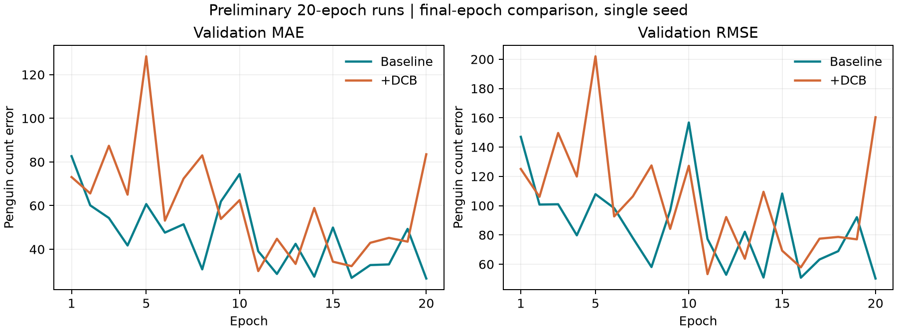

# Preliminary 20-epoch validation results

These records document two actual Apple M5/MPS runs. Both use ImageNet-pretrained VGG-19, seed 42, batch size 1, Adam (lr 1e-5, weight decay 1e-4), the committed 446/146/146 split, and no additional background loss. Each model is evaluated at **epoch 20**, not a validation-selected best checkpoint. The original best-checkpoint policy begins at epoch 101 and therefore was not used here.

| Model | Validation MAE | Validation RMSE | Dataset-level relative count error |
|---|---:|---:|---:|
| Baseline | 26.5969 | 50.2382 | 2.1363% |
| +DCB | 83.5038 | 160.3739 | 49.3860% |

There are 146 validation images containing 23,771 penguins. Baseline predicts 23,263.19 and +DCB predicts 35,510.55. The epoch-20 DCB run substantially overcounts and is worse in all density-tier MAEs. These preliminary results **do not demonstrate a DCB improvement**. A small total-count error is not a per-image accuracy score; overcounts and undercounts can cancel.



## Files

- `comparison.csv`, `tier_comparison.csv`: compact results for downstream reports.
- `baseline/`, `dcb/`: actual checkpoint configuration, training history, run metadata, overall/tier/per-image metrics, density-error decomposition and selected evaluation plots.
- `protocol.json`: environment, seed, manifest hashes and limitations.
- `dataset_split_metadata.json`: source split provenance and overlap-label decision.
- `plot_comparison.py`: regenerates summary CSVs and the learning-curve figure from these committed records.

Model checkpoints remain local under `outputs/baseline_run/epoch20.pt` and `outputs/dcb_run/epoch20.pt`; they are **not included in Git**. Their SHA-256 fingerprints are in each run's metadata. Per-image density/segmentation NPZ predictions also remain local. Metrics JSON files retain the original relative `outputs/...` paths as provenance, not downloadable artifact links.

## Interpretation and limits

- Single-seed, 20-epoch preliminary runs, rather than the proposal's 600-epoch, batch-16 protocol. The test set was not evaluated.
- Baseline was stopped after epoch 5 and resumed; the checkpoint mechanism does not restore RNG/DataLoader state. DCB ran continuously. Shared non-DCB head tensors were not explicitly matched at initialization. The comparison is therefore not an exactly matched architecture-only experiment.
- Both runs use the reconstructed image split and adjudicated LUKE overlaps. The total dataset annotation count is 134,767, different from the proposal's 135,279; see the committed data audit. These are not directly comparable to published metrics on the author's original test split.
- The code commit recorded in metadata is the source state at packaging. Training checkpoints did not embed a git SHA, so an exact training-code SHA is not asserted retroactively.
- The DCB curve fluctuates substantially; do not replace epoch 20 with a better intermediate epoch while comparing against fixed epoch-20 Baseline. Future runs should agree on one checkpoint-selection rule before comparing.
- Density-support `miss_rate`/`bg_fp_rate` are spatial mass diagnostics, not individual-object detector recall/precision. L4 has only 3 validation images.
- Full Top-K hard-negative loss remains separate pending work and was disabled in both runs.

## Reproduction / continued work

Use the actual configurations in each folder together with [the integration runbook](../../docs/integration_runbook.md) and [raw-data setup](../../docs/raw_data_setup.md). Evaluate unmasked predicted density with segmentation probability threshold 0.5, stride 8, against the same validation manifest. Check manifest hashes before comparing new runs.

To regenerate the committed summaries:

```bash
python experiments/preliminary_epoch20/plot_comparison.py
```

Future NVIDIA experiments should use a new output/run directory and record GPU model, driver, CUDA/PyTorch build, training budget, seed and source commit. Keep these MPS records intact. Computer switching and new training are awaiting the user's confirmation.
