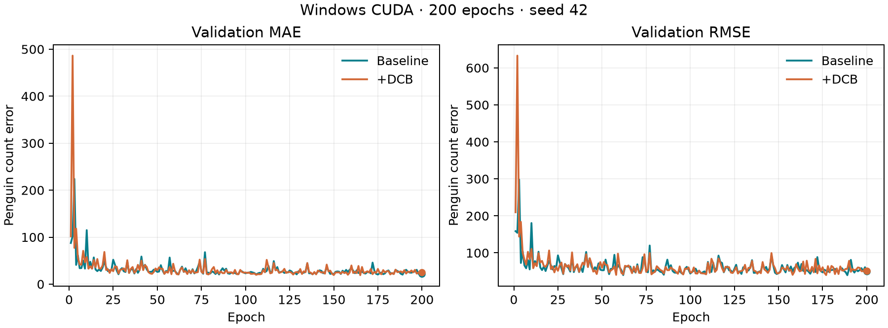

# Windows CUDA Baseline and +DCB at epoch 200

P0 (Baseline) uses a shared VGG-19 encoder and separate segmentation and density heads. P1 (+DCB) inserts parallel 3×3 convolutions with dilation rates 1, 2 and 4 before the heads. A 1×1 projection returns the concatenated features to 512 channels at stride 8.

Each model trained for 200 epochs with an ImageNet-pretrained VGG-19 encoder, seed 42, batch size 1, Adam (learning rate 1e-5, weight decay 1e-4) and the committed 446/146/146 split with LUKE overlap adjudication. The hard-negative background loss was disabled in both runs. We evaluated the final checkpoint on the 146 validation images using segmentation masking at a probability threshold of 0.5.

| Model | Validation MAE | Validation RMSE | Dataset relative count error |
|---|---:|---:|---:|
| Baseline | 21.4794 | 50.5593 | 6.53% |
| +DCB | 25.1238 | 50.7050 | 4.58% |

At epoch 200, +DCB changed validation MAE by +3.6443 and RMSE by +0.1457 relative to Baseline.

The comparison uses one seed and the reconstructed BAS split. The test split was held out. The two heads were initialized through the project defaults, and their initial tensors were not explicitly matched between variants.

+DCB resumed from the completed epoch 161 checkpoint. The trainer restored model and optimizer state. RNG and data-loader state restarted. The GPU and driver at resumption were NVIDIA GeForce RTX 4050 Laptop GPU, 616.56, 6141 MiB.

See `protocol.json` for the source commit, manifest hashes and environment. Each model folder contains its effective configuration, training history and evaluation. Checkpoint SHA-256 values identify the local epoch checkpoints.
