# Current Results Summary: Pygos-Net (Project-wide)

Status: preliminary results, 18 November 2026.
Scope: every experimental run committed under `experiments/`, plus the evaluation, baseline and feasibility analyses. The midterm report is not modified by this document.
Detailed per-tier and mask-effect tables in Sections 4-10 belong to Workstream D; Sections 2-3 and 13 summarize records produced by Workstreams A, B and C.

## 1. Status at a glance

| Area | Evidence committed | Status |
|---|---|---|
| Data pipeline | 738 tiles, 134,767 annotations, 446/146/146 split, manifest hashes | Complete |
| Initial 20-epoch runs (Apple M5/MPS) | `experiments/preliminary_epoch20/` | Complete, preliminary |
| 200-epoch runs (RTX 4050) | `experiments/preliminary_epoch200_windows/` | Complete for baseline and +DCB |
| Best-checkpoint evaluation | `experiments/best_checkpoint_eval/` | Complete for baseline and +DCB |
| +Hard-Negative and Pygos-Net runs | none | Not started |
| Faster R-CNN | feasibility audit only | Complete as reference baseline |
| DEM / terrain extension | none | Stopped (data not available) |
| Test split | none | Held out by design |

## 2. Dataset and splits

| Split | Images | Annotations |
|---|---:|---:|
| Train | 446 | 83,875 |
| Validation | 146 | 23,771 |
| Test (unused) | 146 | 27,121 |
| Total | 738 | 134,767 |

Tier distribution over all 738 tiles: L0 = 179, L1 = 273, L2 = 206, L3 = 55, L4 = 25. L0/L1 tiles are 61.2% of the dataset, which is why aggregate MAE is dominated by sparse background.

The committed split totals 134,767 annotations. The midterm report quotes 135,279 from the original publication; the difference comes from the reconstructed split and LUKE overlap adjudication, and must be reconciled in the report text.

Targets are Gaussian points with sigma = 4 px downsampled to stride 8; count preservation is verified after cropping and downsampling. The effective support threshold is 1e-3.

## 3. Training runs and evaluation views

There are three committed evaluation views. They disagree, so they must not be mixed:

| View | Run | Checkpoint | MAE | RMSE | Relative count error | Pred total vs GT 23,771 |
|---|---|---|---:|---:|---:|---:|
| 20 epochs, MPS | Baseline | epoch 20 | 26.597 | 50.238 | 2.14% | 23,263 |
| 20 epochs, MPS | +DCB | epoch 20 | 83.504 | 160.374 | 49.39% | 35,511 |
| 200 epochs, CUDA | Baseline | final epoch 200 | 21.479 | 50.559 | 6.53% | 22,220 |
| 200 epochs, CUDA | +DCB | final epoch 200 | 25.124 | 50.705 | 4.58% | 24,861 |
| 200 epochs, CUDA | Baseline | best (ep 189) | 20.240 | 39.689 | 2.94% | 24,470 |
| 200 epochs, CUDA | +DCB | best (ep 158) | 19.960 | 40.634 | 3.75% | 24,662 |

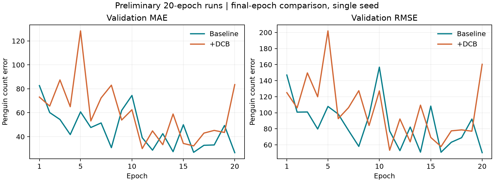

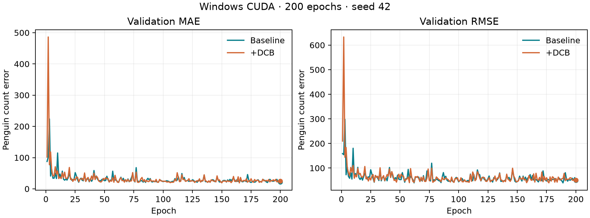

Reading:

1. The 20-epoch +DCB run overcounts massively and is worse in every tier; it is a learning-stability observation, not evidence about DCB.
2. At epoch 200 with a fixed final checkpoint, +DCB is worse in MAE (25.12 vs 21.48) but better in total-count error and bias direction.
3. With best-checkpoint selection (lowest validation MAE + RMSE from epoch 101), +DCB is marginally better in MAE (19.96 vs 20.24) but worse in RMSE. The sign of the DCB effect therefore depends on the selection rule, which is a result in itself.

Both 200-epoch runs used 200 epochs, batch 1, Adam (lr 1e-5, weight decay 1e-4), seed 42 and the hard-negative loss disabled. +DCB resumed from epoch 161 without restoring RNG/DataLoader state.

## 4. Best-checkpoint evaluation protocol

All detailed results below use the best checkpoints, because they are the checkpoints the reports cite for model quality.

| Item | Setting |
|---|---|
| Split | `data/splits/val.jsonl`, 146 tiles, 448x448 |
| GT total | 23,771 penguins |
| Tier distribution | L0 = 35, L1 = 53, L2 = 43, L3 = 12, L4 = 3 |
| Output | density `D` and segmentation probability `S` |
| Counting output | `D_out = D * 1[S >= 0.5]` |
| Grid | stride 8 (56x56) |
| GT support | point cells dilated by radius 1 |
| Checkpoints | baseline epoch 189, +DCB epoch 158 |
| Test split | not evaluated |

## 5. Overall metrics

### 5.1 Final masked output (`D_out`), best checkpoints

| Metric | Baseline | +DCB |
|---|---:|---:|
| MAE | 20.240 | 19.960 |
| RMSE | 39.689 | 40.634 |
| Dataset-level relative count error | 2.94% | 3.75% |
| bias | +4.78 | +6.10 |
| Mean per-image relative error (non-empty) | 22.09% | 22.92% |
| Images over / under / exact | 76 / 44 / 26 | 76 / 47 / 23 |
| Predicted total vs GT 23,771 | 24,470 | 24,662 |

### 5.2 Raw density (`D`, before masking)

| Metric | Baseline | +DCB |
|---|---:|---:|
| Predicted total | 55,640 | 54,552 |
| MAE | 221.34 | 213.95 |
| RMSE | 230.52 | 222.00 |
| Dataset-level relative count error | 134.07% | 129.49% |
| bias | +218.28 | +210.83 |

Raw density is unusable without masking; the mask is a first-class part of the method, not a post-processing detail.

## 6. Per-tier metrics (best checkpoints, masked output)

| Tier | n | GT total | Baseline MAE | Baseline RMSE | Baseline bias | Baseline RCE | +DCB MAE | +DCB RMSE | +DCB bias | +DCB RCE |
|---|---:|---:|---:|---:|---:|---:|---:|---:|---:|---:|
| L0 | 35 | 0 | 1.88 | 5.75 | +1.88 | n/a | 2.09 | 5.36 | +2.09 | n/a |
| L1 | 53 | 2,013 | 12.42 | 20.26 | +7.12 | 18.75% | 11.95 | 19.15 | +6.89 | 18.14% |
| L2 | 43 | 9,558 | 29.46 | 42.40 | +10.39 | 4.67% | 27.96 | 41.73 | +11.47 | 5.16% |
| L3 | 12 | 8,506 | 68.02 | 101.00 | -11.49 | 1.62% | 69.04 | 105.77 | -1.84 | 0.26% |
| L4 | 3 | 3,694 | 49.29 | 49.55 | -17.83 | 1.45% | 58.91 | 61.92 | -6.07 | 0.49% |

+DCB helps sparse and low-density tiles and reduces dense-tier bias, but raises dense-tier RMSE and the L4 MAE. L4 inference is based on only three tiles.

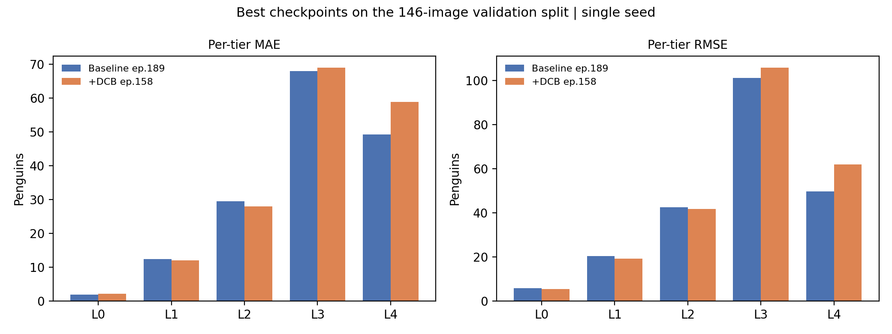

## 7. Error sources (best checkpoints, masked output)

| Tier | Baseline bg FP rate | Baseline miss rate | Baseline excess rate | +DCB bg FP rate | +DCB miss rate | +DCB excess rate |
|---|---:|---:|---:|---:|---:|---:|
| L0 | 1.000 | 0.000 | 0.000 | 1.000 | 0.000 | 0.000 |
| L1 | 0.199 | 0.644 | 0.501 | 0.226 | 0.655 | 0.482 |
| L2 | 0.076 | 0.599 | 0.540 | 0.096 | 0.606 | 0.529 |
| L3 | 0.026 | 0.509 | 0.475 | 0.034 | 0.505 | 0.470 |
| L4 | 0.007 | 0.402 | 0.386 | 0.009 | 0.396 | 0.384 |
| ALL | 0.063 | 0.540 | 0.490 | 0.077 | 0.541 | 0.481 |

`miss_rate` is a cell-level spatial mass mismatch, not the share of penguins missed; the count bias is only +4.8 and +6.1. Background FP rate rises with +DCB (6.31% to 7.71%), which is contrary to the H1 motivation.

## 8. Output-mask effect (D <-> C)

| Tier | Baseline removed bg mass | Baseline suppressed true mass | Baseline suppression rate | +DCB removed bg mass | +DCB suppressed true mass | +DCB suppression rate |
|---|---:|---:|---:|---:|---:|---:|
| L0 | 9,483.7 | 0.0 | 0.00% | 9,107.1 | 0.0 | 0.00% |
| L1 | 12,854.6 | 34.6 | 1.72% | 12,285.0 | 26.4 | 1.31% |
| L2 | 7,221.7 | 42.0 | 0.44% | 7,033.7 | 25.7 | 0.27% |
| L3 | 1,053.5 | 7.6 | 0.09% | 1,019.1 | 7.7 | 0.09% |
| L4 | 174.9 | 1.3 | 0.035% | 169.0 | 0.7 | 0.020% |
| ALL | 30,788.3 | 85.5 | 0.36% | 29,614.0 | 60.6 | 0.25% |

Masking removes 99.3% / 99.2% of L0 raw mass and reduces overall MAE by 201.1 / 194.0. True-target suppression stays at or below 1.72%, so L0/L1 gains are not obtained by suppressing penguins in dense colonies. Dense-tier undercounting originates in density regression, not in the mask.

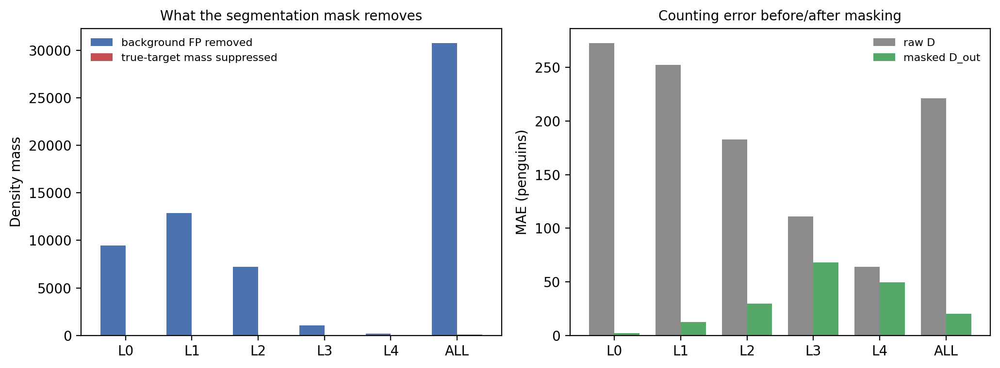

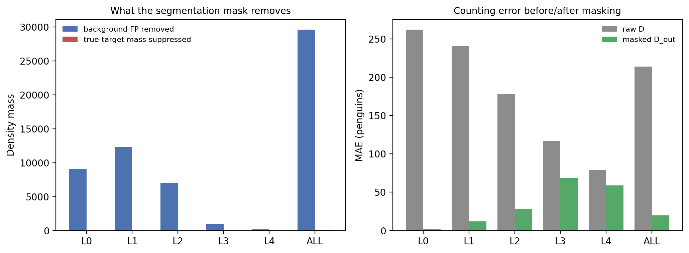

## 9. Counting behaviour

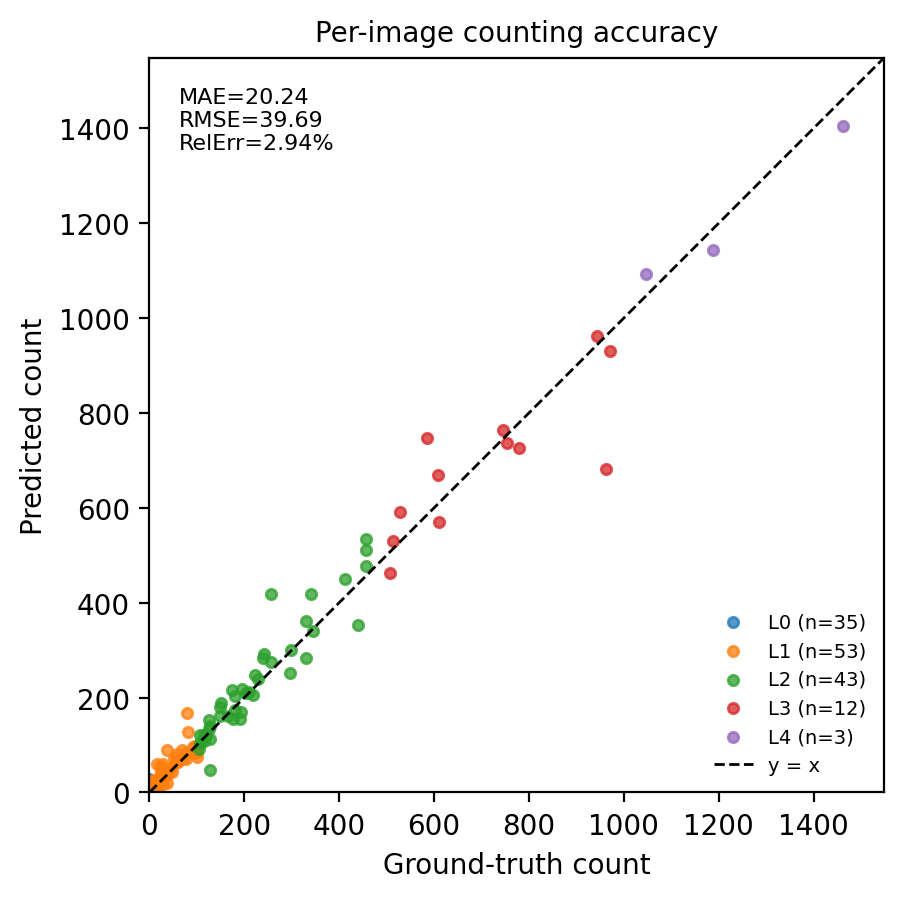

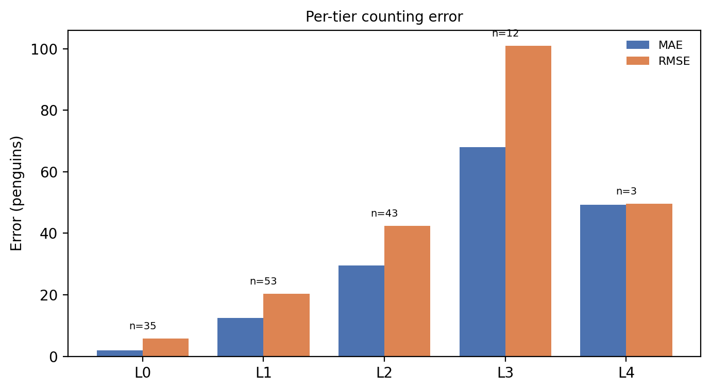

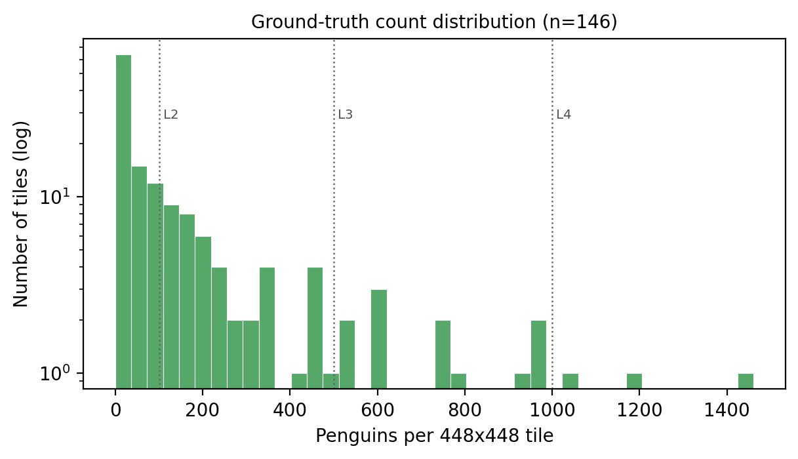

88 of 146 validation tiles are L0/L1, while three tiles carry 3,694 penguins in L4. Aggregate MAE is therefore dominated by sparse tiles, and the tier table is the primary evidence.

## 10. Qualitative error analysis

| Category | Evidence | Figure |
|---|---|---|
| Zero-count / snow, ice and wet rock | 35 empty tiles average 272.8 raw counts but only 1.9 after masking. Raw responses scatter over bright snow/ice and dark rock; the mask leaves 1 count. | `best_checkpoint_eval/baseline/figures/case_01_L0_bg_fp_rate.png` |
| Sparse colony on dark rock / water | GT 7; raw prediction 292 over rock and water; masking keeps the guano-covered cluster and yields 6.8. | `best_checkpoint_eval/baseline/figures/case_03_L1_bg_fp_rate.png` |
| Dense colony | GT 1,461; raw 1,428, masked 1,405. The mask transmits 98% of mass; residual error is spatially mixed. | `best_checkpoint_eval/baseline/figures/case_10_L4_bg_fp_rate.png` |
| Mid-density boundary case | GT 127, raw 296, masked 46.9. The mask removes 84% of raw mass, but only 9.6 units were true target mass (7.5% of this tile's GT); +DCB gives 71.5 on the same tile. | `best_checkpoint_eval/baseline/figures/case_06_L2_miss_rate.png` |
| Dense-cluster merging | Excess rate 0.49 overall, 0.39 on L4; responses in colony cores exceed the point count. | `best_checkpoint_eval/baseline/figures/case_07_L2_excess_rate.png`, `case_09_L3_excess_rate.png` |

All ten baseline panels and nine +DCB panels are listed in `best_checkpoint_eval/*/case_gallery.csv`. Each panel contains: input with points, GT density, raw prediction, segmentation support, masked prediction, and signed error.

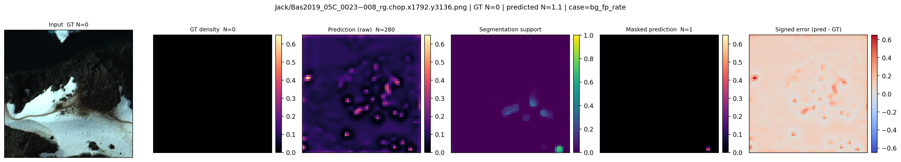

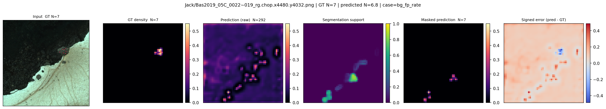

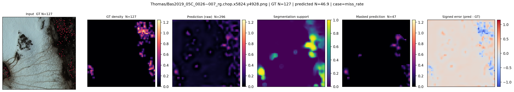

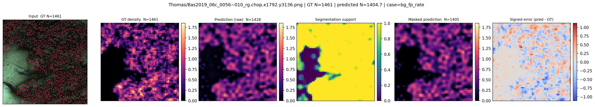

## 11. Hypothesis status

| Hypothesis | Status | Evidence |
|---|---|---|
| H1: DCB reduces background false positives and maintains accuracy | Not supported as stated | L1/L2 MAE improve and best-checkpoint MAE drops by 0.28, but background FP rate rises 6.31% -> 7.71%, RMSE and relative count error worsen |
| H2: `Lbg` gives the largest L0/L1 improvement | Untested | +Hard-Negative checkpoint not trained |
| H3: Full model gives the best trade-off without L3/L4 degradation | Untested | Pygos-Net checkpoint not trained |

## 12. Ablation coverage and remaining work

| Configuration | DCB | `Lbg` | Runs | Best val MAE |
|---|---:|---:|---|---:|
| Baseline | no | no | 20-epoch MPS, 200-epoch CUDA | 20.240 (ep 189) |
| +DCB | yes | no | 20-epoch MPS, 200-epoch CUDA | 19.960 (ep 158) |
| +Hard-Negative | no | yes | none | n/a |
| Pygos-Net | yes | yes | none | n/a |

Remaining:

1. Train +Hard-Negative and Pygos-Net with the same budget; evaluate with the same `scripts/evaluate.py`.
2. Reconcile protocol text (600 epochs, batch 16) with actual runs (200 epochs, batch 1).
3. Implement per-tile density correlation and SSIM, which the midterm report promises but the eval package does not yet compute.
4. Add multi-seed repeats for the configurations supporting the main claim.
5. Evaluate the test split once after the configuration is frozen.

## 13. Reference baselines and optional extension

### 13.1 Faster R-CNN feasibility

| Statistic | Value |
|---|---:|
| Images with boxes / boxes | 558 / 137,187 |
| Median box size (longest side) | 6 px |
| p95 / max longest side | 8 px / 20 px |
| Share <= 8 px | 97.3% |
| Distinct width-height pairs | 158 |

Verdict: `suitable_as_primary_method = false`, `usable_as_reference_baseline = true`. Raw output: `baselines/faster_rcnn_feasibility.json`. No detector was trained, because point annotations are not valid ground-truth boxes.

### 13.2 DEM / terrain extension

Stopped. The data contain no georeferenced coordinates and no co-located DEM or slope raster, so elevation alignment and effort normalization are impossible. `src/pygosnet/eco/` is intentionally empty; the decision and restart conditions are documented in `docs/eval_protocol.md`.

## 14. Verification and reproducibility

- Test suite: 88 tests pass, covering data loading/count preservation, model shapes and gradients, losses, tier metrics, error decomposition, masking and case selection.
- Metrics JSON keeps provenance: split, mask threshold, stride, support radius, checkpoints and environment.
- Committed checkpoints are the best-epoch files used here; `protocol.json` records commit `2fe07ad`, manifest SHA-256 hashes, GPU and resumptions.
- Test split remains untouched.

## 15. Caveats

1. 200 epochs, not the 600-epoch budget; batch 1 instead of the configured 16 (6 GB GPU).
2. Single seed (42); +DCB resumed from epoch 161 without restoring RNG state, so it is not bit-reproducible.
3. Best-checkpoint and final-epoch views disagree on the DCB effect; the selection rule must be stated whenever results are quoted.
4. L4 has three validation tiles and L3 has twelve; dense-tier RMSE changes are high-variance.
5. Two of four ablation configurations are missing.
6. `miss_rate` and `excess_rate` are cell-level mass ratios; report them with definitions.
7. The 20-epoch MPS runs are not comparable with the 200-epoch CUDA runs.

## 16. Artifacts

| Artifact | Content |
|---|---|
| `preliminary_epoch20/comparison.csv`, `tier_comparison.csv` | 20-epoch runs, overall and per-tier |
| `preliminary_epoch200_windows/comparison.csv` | 200-epoch final-checkpoint results |
| `preliminary_epoch200_windows/checkpoints/best-validation.md` | Best-checkpoint summary |
| `preliminary_epoch200_windows/checkpoints/best-density-comparison.png` | Median-density qualitative comparison (generated manually) |
| `best_checkpoint_eval/comparison.csv` | Overall, per-tier and mask-effect summary |
| `best_checkpoint_eval/{baseline,plus_dcb}/` | Metrics, per-image tables, error sources, mask effect, case galleries |
| `best_checkpoint_eval/{baseline,plus_dcb}/figures/` | Six-panel case figures |
| `baselines/faster_rcnn_feasibility.json` | Bounding-box audit |
| `docs/eval_protocol.md` | Metric definitions, protocol and reproduction |

Reproduce the detailed evaluation (predictions are cached):

```bash
python scripts/evaluate.py --manifest data/splits/val.jsonl \
    --pred-dir outputs/best_checkpoint_eval/<run>_predictions \
    --use-seg --case-figures 3 --project-root . \
    --out-dir experiments/best_checkpoint_eval/<run>
```
